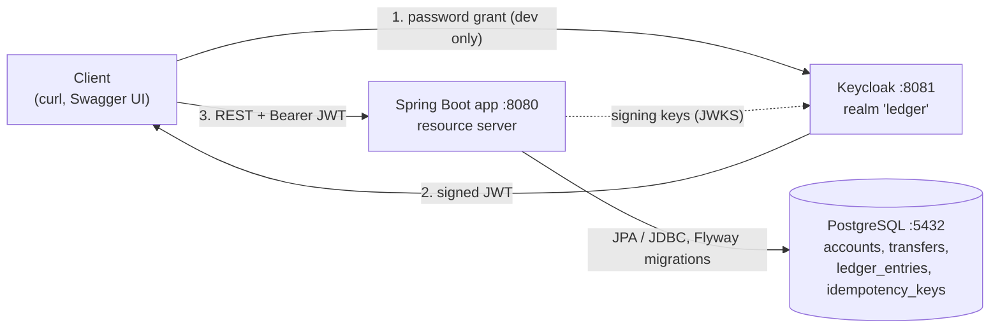

# Payments Ledger Service

A double-entry payments ledger with idempotent transfers, ordered locking, reversals and reconciliation. Every transfer writes one debit and one credit that sum to zero, retries with the same `Idempotency-Key` never move money twice, concurrent transfers cannot deadlock or lose money, and a read-only job checks that balances still equal the sum of their entries. Built with Java 21, Spring Boot 4.1, Spring Data JPA, PostgreSQL 17 with Flyway migrations, Keycloak (OAuth2 JWTs), Maven, Testcontainers, Docker Compose and GitHub Actions. 293 tests.

## Quick start
Needs Docker (Docker Desktop on Windows and macOS). The first run downloads images and Maven dependencies, so it takes a few minutes.

```
docker compose up --build
```

This starts Postgres (5432), Keycloak (8081) and the app (8080), in that order: the app waits until the other two are healthy. When it is up:

```
curl http://localhost:8080/actuator/health
```

**Get a token.** The dev realm has `alice` and `bob` (role USER) and `admin-user` (role ADMIN); their passwords are `alice-dev-password`, `bob-dev-password` and `admin-dev-password` (local-dev values, see Security). [`api.http`](api.http) has a login request and one example call for every endpoint (VS Code REST Client). Or open Swagger UI at <http://localhost:8080/swagger-ui.html>, get a token with the curl below, and paste it under **Authorize**.

**First calls** (Git Bash, macOS or Linux; on a fresh database alice's new account has id 3):

```
token() { curl -s -d grant_type=password -d client_id=ledger-api -d username="$1" -d password="$2" \
  http://localhost:8081/realms/ledger/protocol/openid-connect/token | sed 's/.*"access_token":"\([^"]*\)".*/\1/'; }
ALICE=$(token alice alice-dev-password)
ADMIN=$(token admin-user admin-dev-password)

# alice opens a EUR account
curl -s -X POST http://localhost:8080/accounts -H "Authorization: Bearer $ALICE" \
  -H 'Content-Type: application/json' -d '{"currency":"EUR"}'

# the admin deposits 100.00 EUR (amounts are integer minor units); repeating this exact call replays the response
curl -s -X POST http://localhost:8080/accounts/3/deposits -H "Authorization: Bearer $ADMIN" \
  -H 'Idempotency-Key: demo-deposit-1' -H 'Content-Type: application/json' -d '{"amount":10000,"currency":"EUR"}'

# alice reads her balance
curl -s http://localhost:8080/accounts/3/balance -H "Authorization: Bearer $ALICE"
```

- Stop, keeping the data: `docker compose down`.
- **Reset to an empty database:** `docker compose down -v` (also deletes the `payments-ledger_pgdata` volume), then start again.
- To run the app from your IDE or `./mvnw spring-boot:run`, start only the dependencies: `docker compose up -d postgres keycloak`. A bare `docker compose up` also starts the app, on port 8080, so the two would clash.

## Architecture


**A transfer (`POST /transfers`), in one database transaction:**
1. Validate the JWT and read `sub` (the caller) and the realm roles.
2. Insert the `Idempotency-Key` row first. If the key already exists, wait for the other request, then replay its stored response (same body) or reject a different body with `IDEMPOTENCY_KEY_REUSED`.
3. Check the caller owns the source account (admins may use any), then lock both accounts with `SELECT ... FOR UPDATE` in ascending id order.
4. Check currency and funds, then write one `DEBIT` and one `CREDIT` entry, update both cached balances, and store the response on the key row.
5. Commit. Any failure rolls back everything, including the key row, so nothing is half-written and failures are never replayed.

Code is packaged by feature: `account`, `transfer`, `ledger`, `idempotency`, `reconciliation`, `common` (under `com.zainali.ledger`).

## Key design decisions
Each is written up with alternatives in [`docs/DECISIONS.md`](docs/DECISIONS.md).

- **Double-entry with a cached balance** (decisions 4, 5): every transfer is a debit and a credit of the same positive amount, so signed entries sum to zero; `accounts.balance` is a cached copy updated in the same transaction. *Why:* the entries are the source of truth, and the cache makes the funds check cheap.
- **Money as integer minor units** (3): `BIGINT` cents plus a currency code (EUR, USD), never floating point. *Why:* exact arithmetic; a fractional amount is rejected, not truncated.
- **Idempotency keys** (9, 16): the key row is inserted first under a unique `(owner, key)` constraint. *Why:* the database, not a check-then-insert in code, serialises concurrent duplicates, so two simultaneous identical requests move money once.
- **Ordered pessimistic locking** (8): every transaction locks the accounts it touches in ascending id order. *Why:* a fixed lock order makes deadlocks impossible, so there is no retry logic. A test with 50 concurrent transfers on one account checks no money is created or lost, and breaking the order makes it fail with real deadlocks.
- **Append-only ledger, enforced in the database** (13): triggers reject `UPDATE`, `DELETE` and `TRUNCATE` on `ledger_entries`, and check constraints enforce non-negative balances and consistent currencies. *Why:* a bug in the service layer cannot rewrite history.
- **Reversals as new entries** (10): a reversal is a new transfer with swapped accounts and two new entries; the original is only marked `REVERSED`. A unique constraint allows one reversal per transfer. *Why:* history is never edited, and "once only" holds even under races.
- **Reconciliation** (19): a scheduled job and `POST /admin/reconciliation` check that each transfer's entries sum to zero and each cached balance equals its entries, in one read-only snapshot with no locks. *Why:* it detects drift without blocking transfers, and reports it instead of silently "fixing" it.
- **Hidden ids** (15, 17): an account or transfer you may not see returns the same 404 as a missing one. *Why:* ids are sequential, so anything else would let callers probe which ids exist.

## Tests
Needs Docker running (Testcontainers starts a real PostgreSQL 17; the first run pulls the image and is slow).

```
./mvnw clean verify        # Git Bash / macOS / Linux
.\mvnw clean verify        # PowerShell
```

293 tests, none skipped, also run in GitHub Actions on every push:
- **110 unit tests** (Mockito, no database): services, check order, lock order, request hashing, role mapping, sort parsing, transaction settings.
- **183 integration tests** (Spring Boot + Testcontainers PostgreSQL, real migrations): every endpoint with its error codes and 401/403/404 rules; idempotent replay and key reuse; the migrations and the database constraints and append-only triggers (19); the OpenAPI description against the real endpoints; reconciliation, which corrupts balances and entries on purpose and checks they are detected.
- **Concurrency tests:** 50 concurrent transfers on one hot account (25 in, 25 out) and all ordered pairs among five accounts at once, then checks that the total is unchanged and every balance equals its entries; 8 concurrent reversals of one transfer give exactly one success; concurrent requests with the same key give one result and replays; a stale-write test for the optimistic-version backstop.
- **Invariant checks** after the API tests: entries sum to zero per transfer, cached balances equal entry sums.

## API overview
Interactive docs: Swagger UI at <http://localhost:8080/swagger-ui.html>, OpenAPI at <http://localhost:8080/v3/api-docs>. Money is integer minor units. Writes marked **key** need an `Idempotency-Key` header (max 255 characters).

| Method | Path | Role | Notes |
|---|---|---|---|
| GET | `/actuator/health` | public | Health and readiness. |
| POST | `/accounts` | USER, ADMIN | Body `{"currency": "EUR" or "USD", "ownerId": optional}`. Creates a customer account for the caller (only an ADMIN may set another owner). 201. |
| GET | `/accounts` | owner, ADMIN | Your accounts; an ADMIN sees all. Not paginated. |
| GET | `/accounts/{id}` | owner, ADMIN | 404 if missing or not yours. |
| GET | `/accounts/{id}/balance` | owner, ADMIN | The cached balance, which equals the sum of the entries. |
| GET | `/accounts/{id}/transactions` | owner, ADMIN | Ledger entries, paged. `page`, `size` (default 20, max 100), `sort` = `createdAt` or `amount` with `,asc` or `,desc`, `from` (inclusive) and `to` (exclusive) as ISO-8601 instants. |
| POST | `/accounts/{id}/deposits` | ADMIN | **key.** Body `{"amount": 1 to 10^12, "currency"}`. Moves money from the currency's `EXTERNAL` account. 201. |
| POST | `/transfers` | owner of source, ADMIN | **key.** Body `{"sourceAccountId", "targetAccountId", "amount", "currency"}`. 201 with `Location`. |
| GET | `/transfers/{id}` | party to it, ADMIN | 404 for anyone else. |
| POST | `/transfers/{id}/reverse` | ADMIN | **key.** No body. Creates a `REVERSAL` and marks the original `REVERSED`. Only a completed `TRANSFER`, only once. |
| POST | `/admin/reconciliation` | ADMIN | Runs the checks and returns the report (200 even if it finds mismatches). |

A repeated key with the same body returns the original response plus `Idempotency-Replayed: true`. A failed request stores nothing under its key, so a retry runs again (an `INSUFFICIENT_FUNDS` transfer can succeed once the account is funded).

**Errors** are RFC 7807 problem responses with a stable `code`:

| Status | Codes |
|---|---|
| 400 | `VALIDATION_FAILED`, `IDEMPOTENCY_KEY_REQUIRED` |
| 403 / 404 / 500 | `FORBIDDEN`, `NOT_FOUND`, `INTERNAL_ERROR` |
| 422 | `INSUFFICIENT_FUNDS`, `SAME_ACCOUNT`, `CURRENCY_MISMATCH`, `EXTERNAL_ACCOUNT_NOT_ALLOWED`, `IDEMPOTENCY_KEY_REUSED`, `NOT_REVERSIBLE`, `ALREADY_REVERSED` |

A missing or invalid token gives 401, and a missing role gives 403, from the security filter chain with an empty body (not the problem format yet; see limitations).

## Security notes
- The app is a stateless OAuth2 resource server: every endpoint except health and the API docs needs a Keycloak JWT. Realm roles `USER` and `ADMIN` become Spring authorities; the account owner is the token's `sub`. The filter chain is default-deny, and ownership is checked in the services (DECISIONS 14, 15).
- **Everything in the repository is for local development only**: the Postgres password (`ledger`), the Keycloak admin login (`admin`/`admin`), the realm users' passwords and the public `ledger-api` client with the password grant. They are defaults in `compose.yaml` and `keycloak/ledger-realm.json`, can be overridden with environment variables or a git-ignored `.env`, and must never be reused. Keycloak runs in dev mode over plain http.
- The Docker image contains no secrets and runs as a non-root user (DECISIONS 21).
- **Swagger UI and the OpenAPI description are public** so the page can load before you click Authorize. In production disable or restrict them: `springdoc.api-docs.enabled=false` and `springdoc.swagger-ui.enabled=false` (DECISIONS 20).
- Tokens fetched at `localhost:8081` work inside the container because Keycloak's hostname is fixed to that address (DECISIONS 21).

## Limitations and what I would do next
Known gaps, tracked in [`docs/PLAN.md`](docs/PLAN.md):
- **No lock timeouts.** A request can wait on a row lock or on a duplicate key's transaction indefinitely, and a burst of duplicates can use up the connection pool. Next: Postgres `lock_timeout` and `statement_timeout`, mapped to a clear error.
- **Hot `EXTERNAL` row.** Every deposit in a currency locks that one account, so deposits run one at a time (acceptable for an admin operation). Rejected transfers to it also lock it before being refused.
- **Idempotency keys are never deleted**, so the table grows. Next: a scheduled cleanup after a retention period.
- **Offset paging** on transaction history gets slower on deep pages and can shift while data is inserted. Keyset paging on `(createdAt, id)` is the fix. `GET /accounts` is not paginated.
- **Sequential `BIGINT` ids** are guessable; ownership checks hide them, but UUIDs would be better. A transfer to a nonexistent target returns 404, so callers can probe which account ids exist.
- **Error format gaps:** 401 and 403 from the filter chain are not problem documents; request bodies with unknown fields are ignored; a balance overflow would surface as a 500; the JWT audience is not validated.
- **Observability is not built yet:** no metrics (transfer counts, failures, latency), structured logs with correlation ids, or Prometheus and Grafana (milestone 11). There is also no coverage report (milestone 14) and no formal hardening review (milestone 13).
- Multiple app instances would each run the reconciliation job (harmless, since it is read-only, but wasteful).
